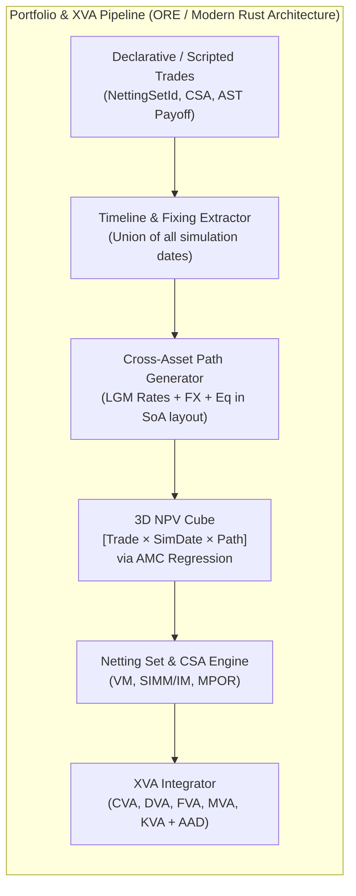

# 03. Cross-Language Benchmark Architectures: How Post-QuantLib Systems Solved QuantLib's Flaws

To design a state-of-the-art Rust quantitative finance library, we must study not only C++ `QuantLib` and existing Rust crates, but also the five most influential **post-QuantLib architectures** built across Java, C++, Python/Rust, and JAX/XLA over the past 15 years. Each of these systems was explicitly created by institutional quants to overcome specific architectural dead-ends in C++ QuantLib.

---

## 1. OpenGamma Strata (Java): Deep Immutability, Value-Type Conventions & Vectorized Scenarios

> **Reference**: [`https://github.com/OpenGamma/Strata`](https://github.com/OpenGamma/Strata) (Apache-2.0)

When OpenGamma's quantitative engineering team (including Marc Henrard, author of [`03_Henrard_2011_AAD_Calibration_Implicit_Function_Theorem.pdf`](file:///home/jakeshea/rust_quantlib/papers/03_Henrard_2011_AAD_Calibration_Implicit_Function_Theorem.pdf)) designed **Strata**, they threw out QuantLib's stateful object graph and established four architectural laws that map directly to idiomatic Rust:

### 1.1 Elimination of the `Observer` Pattern via Deep Immutability
- In QuantLib, instruments hold `Handle<YieldTermStructure>` pointers to live mutable curves, which hold `Handle<Quote>` pointers to mutable quotes.
- In **Strata**, **every domain object, trade, schedule, curve, and market data container is 100% immutable**.
- Trades never hold pointers to curves or pricing engines. Instead, a trade holds only lightweight, serializable value identifiers (e.g., `CurveId`, `Index`, `Currency`).
- Because nothing is mutable, there is **no `Observer`, no `Observable`, no `LazyObject`, and no mutex locking**. A `RatesProvider` (an immutable snapshot of calibrated curves and FX rates at a specific `valuationDate`) can be shared across 128 CPU threads with zero synchronization overhead.

### 1.2 The `TradeSpec` $\xrightarrow{\text{resolve}}$ `ResolvedTrade` Two-Stage Pipeline
- In QuantLib, schedule generation, calendar business-day rolling, and day-count fraction calculations are intertwined with stateful `Coupon` and `Instrument` objects that re-evaluate when the global `evaluationDate` changes.
- Strata separates **Contract Specification** from **Resolved Contract**:
  1. **`SwapTrade` / `SwapConvention` (High-Level Specification)**: Expresses a trade in market-standard terms (e.g., *"Buy 100M USD 10Y SOFR OIS at 3.85%, Effective 2026-10-23"*).
  2. **`.resolve(ReferenceData)` $\rightarrow$ `ResolvedSwap` (Compiled Cashflow Table)**: Uses holiday calendars and conventions from `ReferenceData` **once** to expand the specification into flat, immutable arrays of concrete accrual dates, payment dates, fixing dates, and year fractions.
  3. **Stateless Pricer (`DiscountingSwapProductPricer`)**: A zero-state struct whose methods (`presentValue(resolvedSwap, ratesProvider)`, `parRate(...)`, `presentValueSensitivity(...)`) are **pure mathematical functions** operating on `ResolvedSwap` and `RatesProvider`.

### 1.3 Memory-Efficient Scenario Valuation (`MarketDataBox<T>`)
- When running 10,000 historical VaR or stress scenarios, only a subset of curves/quotes might be shocked in a given scenario.
- Strata's `ScenarioMarketData` wraps each market entry in a `MarketDataBox<T>`, which is an algebraic sum type:
  $$\text{MarketDataBox}\langle T \rangle = \text{SingleValue}(T) \;\mid\; \text{ScenarioArray}(\text{Vec}\langle T \rangle)$$
- In Rust, this is a zero-cost `enum MarketDataEntry<'a, T> { Shared(&'a T), Perturbed(&'a [T]) }`, allowing vectorized scenario loops without duplicating unshocked market data.

---

## 2. Open Source Risk Engine (`ORE`, C++): Portfolio NPV Cubes, Netting Sets & Scripted Trades

> **Reference**: [`https://github.com/OpenSourceRisk/Engine`](https://github.com/OpenSourceRisk/Engine) (Quaternion / Acadia / LSEG) & Kenyon & Green (2014) [`12_Kenyon_Green_2014_Efficient_XVA_Management_Regression.pdf`](file:///home/jakeshea/rust_quantlib/papers/12_Kenyon_Green_2014_Efficient_XVA_Management_Regression.pdf)

C++ QuantLib was designed in 2000 to price **one instrument at a time** at $t = 0$. Post-2008 regulations (Basel III CVA, BILATERAL Initial Margin / SIMM, FVA, MVA, KVA) shifted quantitative finance from single-trade valuation to **portfolio-wide simulation over future time horizons**.

`ORE` was built on top of QuantLib to bridge this gap, revealing what a modern library must support natively rather than as an external wrapper:



1. **First-Class Netting Envelopes & CSAs**: Every trade belongs to a `NettingSetId` governed by a Credit Support Annex (`CSA`: thresholds, minimum transfer amounts, margin period of risk `MPOR`, collateral currencies, and Initial Margin models).
2. **The 3D NPV Cube (`[Trade × Date × Path]`)**: Instead of each instrument running its own private Monte Carlo loop, a central Cross-Asset Simulation Engine evolves correlated state variables across a shared time grid and populates a contiguous 3D NPV Cube.
3. **American Monte Carlo (AMC) Inside the Cube**: For Bermudan swaptions, callable bonds, and path-dependent exotics, conditional expectation polynomials (Longstaff-Schwartz / regression basis) trained during backward induction are evaluated across forward simulation dates so every cell `(trade, date, path)` in the NPV Cube is populated without nested Monte Carlo.

---

## 3. `rateslib` (Python / Rust): Forward-Mode `Dual`/`Dual2` & Global Multi-Curve IFT Jacobians

> **Reference**: [`/home/jakeshea/rust_quantlib/repos/rateslib/rust/`](file:///home/jakeshea/rust_quantlib/repos/rateslib/rust/) & Bianchetti (2009) [`14_Bianchetti_2009_Two_Curves_One_Price_MultiCurve.pdf`](file:///home/jakeshea/rust_quantlib/papers/14_Bianchetti_2009_Two_Curves_One_Price_MultiCurve.pdf)

Inspecting [`repos/rateslib/rust/`](file:///home/jakeshea/rust_quantlib/repos/rateslib/rust/) (74,468 LOC of Rust) shows why modern fixed-income desks are moving away from QuantLib's sequential 1D curve bootstrapper:

### 3.1 Sequential 1D Bootstrap vs. Global AD-Jacobian Multi-Curve Solver
- In C++ QuantLib ([`ql/termstructures/iterativebootstrap.hpp`](file:///home/jakeshea/rust_quantlib/repos/QuantLib/ql/termstructures/iterativebootstrap.hpp)), a curve with 30 pillars is solved via 30 sequential 1D Brent root-finders. This fails or requires awkward workarounds ([`ql/termstructures/multicurve.hpp`](file:///home/jakeshea/rust_quantlib/repos/QuantLib/ql/termstructures/multicurve.hpp)) when:
  - Multiple curves depend on each other cyclically (e.g., SOFR discounting + EUR ESTR discounting + EURUSD FX-implied cross-currency curve).
  - Calibration instruments overlap or outnumber pillars (e.g., fitting a smooth cubic B-spline or central-bank FOMC/ECB meeting step-function curve to a dense set of OIS swaps, SOFR futures, and turn-of-year FRAs).
- `rateslib` solves the entire multi-curve system simultaneously as a nonlinear system $\mathbf{H}(\mathbf{z}, \mathbf{R}) = \mathbf{0}$ (where $\mathbf{z} \in \mathbb{R}^N$ are all curve pillar parameters across all curves, and $\mathbf{R} \in \mathbb{R}^M$ are market par quotes) using **Newton-Raphson / Levenberg-Marquardt with exact `Dual` Jacobians** $\frac{\partial \mathbf{H}}{\partial \mathbf{z}}$.

### 3.2 Exact 1st-Order Delta & 2nd-Order Cross-Gamma via IFT
- Because `rateslib` implements both `Dual` (first-order gradient) and `Dual2` (first-order gradient + **second-order Hessian matrix** `dual2: Array2<f64>` in [`repos/rateslib/rust/dual/dual.rs:36-41`](file:///home/jakeshea/rust_quantlib/repos/rateslib/rust/dual/dual.rs#L36-L41)), a single valuation of a swap portfolio in `Dual2` mode yields both $\nabla_{\mathbf{z}} V$ and the exact Hessian $\nabla^2_{\mathbf{z}\mathbf{z}} V$ with respect to curve nodes.
- Applying the Implicit Function Theorem (Henrard 2011, [`03_Henrard_2011_AAD_Calibration_Implicit_Function_Theorem.pdf`](file:///home/jakeshea/rust_quantlib/papers/03_Henrard_2011_AAD_Calibration_Implicit_Function_Theorem.pdf)) transforms node sensitivities into market par-rate Deltas and **exact $M \times M$ Cross-Gamma tables** in milliseconds—compared to $\frac{M(M+1)}{2}$ full multi-curve re-bootstraps required by finite-difference bumping in C++ QuantLib!

---

## 4. Antoine Savine's `CompFinance` & `Scripting` (C++): Block-Arena AAD & Fuzzy AST Scripting

> **Reference**: [`/home/jakeshea/rust_quantlib/repos/CompFinance`](file:///home/jakeshea/rust_quantlib/repos/CompFinance) & [`/home/jakeshea/rust_quantlib/repos/Scripting`](file:///home/jakeshea/rust_quantlib/repos/Scripting)

From our direct inspection of Savine's headers, three production engineering techniques stand out:

1. **Separated Block-Arena Tape ([`CompFinance/AADTape.h:39-46`](file:///home/jakeshea/rust_quantlib/repos/CompFinance/AADTape.h#L39-L46))**:
   - Instead of storing a fat struct per tape vertex (like `RustQuant_autodiff::Vertex`), Savine separates `myNodes`, `myDers` (partial derivatives), and `myArgPtrs` (parent adjoint pointers) into distinct contiguous `blocklist` slab arenas, with 64-byte cache-line padding (`char myPad[64]`) between thread-local tapes to eliminate false sharing across CPU cores.
   - `tape.mark()` and `tape.rewindToMark()` ([`CompFinance/AADTape.h:135-156`](file:///home/jakeshea/rust_quantlib/repos/CompFinance/AADTape.h#L135-L156)) allow a 100,000-path Monte Carlo simulation to reuse the exact same L1/L2-cache-resident memory block for every path!
2. **AST-to-Bytecode Compilation ([`Scripting/scriptingCompiler.h:92-780`](file:///home/jakeshea/rust_quantlib/repos/Scripting/scriptingCompiler.h#L92-L780))**:
   - Traversing a pointer-based tree of `unique_ptr<Node>` with virtual visitor calls on every Monte Carlo path causes heavy branch misprediction and instruction-cache misses.
   - `scriptingCompiler.h` compiles the AST into three flat `std::vector` streams (`myNodeStream` of integer opcodes with specialized constant-folded instructions like `AddConst`, `MultConst`, `PaysConst`; `myConstStream` of `double`s; and `myDataStream`), which `evalCompiled<T>` executes on a flat stack (`staticStack<T> dStack`).
3. **Static Fuzzy Smoothing for Pathwise AAD ([`Scripting/scriptingFuzzyEval.h:26-302`](file:///home/jakeshea/rust_quantlib/repos/Scripting/scriptingFuzzyEval.h#L26-L302))**:
   - Digital payoffs, barrier knock-outs, and autocallable triggers contain step functions $\mathbb{I}(x > 0)$ whose pathwise derivative is zero almost everywhere and infinite at $x = 0$.
   - Savine's `DomainProcessor` and `FuzzyEvaluator` statically analyze the AST before simulation, identify which variables (`affectedVars` in [`Scripting/scriptingNodes.h:174`](file:///home/jakeshea/rust_quantlib/repos/Scripting/scriptingNodes.h#L174)) are mutated inside an `If` branch, and automatically evaluate a smooth degree-of-truth $dt \in [0, 1]$ (via call-spread `cSpr` or butterfly `bFly` kernels of width $\epsilon$), blending the true/false state transitions via `dt * varTrue + (1.0 - dt) * varFalse` ([`Scripting/scriptingFuzzyEval.h:197`](file:///home/jakeshea/rust_quantlib/repos/Scripting/scriptingFuzzyEval.h#L197))!

---

## 5. Functional Contract Combinators (Peyton Jones & Eber 2000; Bahr, Berthold & Elsman 2015)

> **Reference**: [`15_PeytonJones_Eber_Seward_2000_Composing_Contracts.pdf`](file:///home/jakeshea/rust_quantlib/papers/15_PeytonJones_Eber_Seward_2000_Composing_Contracts.pdf) & [`16_Bahr_Berthold_Elsman_2015_Symbolic_Financial_Contracts.pdf`](file:///home/jakeshea/rust_quantlib/papers/16_Bahr_Berthold_Elsman_2015_Symbolic_Financial_Contracts.pdf)

While Savine's scripting language is imperative (`Assign`, `If`, `Pays`), Peyton Jones, Eber & Seward (adopted in production by LexiFi's MLFi) and Bahr et al. (HIPERFIT) showed that **almost all financial contracts can be expressed declaratively using 10 algebraic combinators**:

```rust
pub enum Contract<S> {
    Zero,                                      // Pays nothing
    One(Currency),                             // Pays 1 unit of Currency immediately
    Give(Box<Contract<S>>),                    // Reverses rights and obligations (short position)
    And(Box<Contract<S>>, Box<Contract<S>>),   // Both contracts
    Or(Box<Contract<S>>, Box<Contract<S>>),    // Holder chooses between C1 and C2
    Cond(Obs<bool, S>, Box<Contract<S>>, Box<Contract<S>>), // Conditional branch on observable
    Scale(Obs<S, S>, Box<Contract<S>>),        // Scales cashflows by a numerical observable
    When(Obs<bool, S>, Box<Contract<S>>),      // Acquires C when observable becomes true
    Anytime(Obs<bool, S>, Box<Contract<S>>),   // American/Bermudan choice when obs is true
    Until(Obs<bool, S>, Box<Contract<S>>),     // Knock-out / barrier termination when obs is true
}
```

### Why Rust Is the Ideal Host Language for Both Paradigms
In C++, implementing algebraic contract combinators with pattern matching and equational rewriting (`simplify`, `horizon_advance`, `fuzzy_smooth`, `compile_to_bytecode`) requires hundreds of lines of boilerplate `Visitor` classes. In Rust, `enum Contract` + exhaustive `match` + arena allocation (`bumpalo` or index-based flat AST `Vec<ContractNode>`) makes symbolic contract manipulation, causality checking (Bahr et al. 2015), and lowering to Savine-style flat bytecode (`Vec<OpCode>`) completely natural and type-safe!
